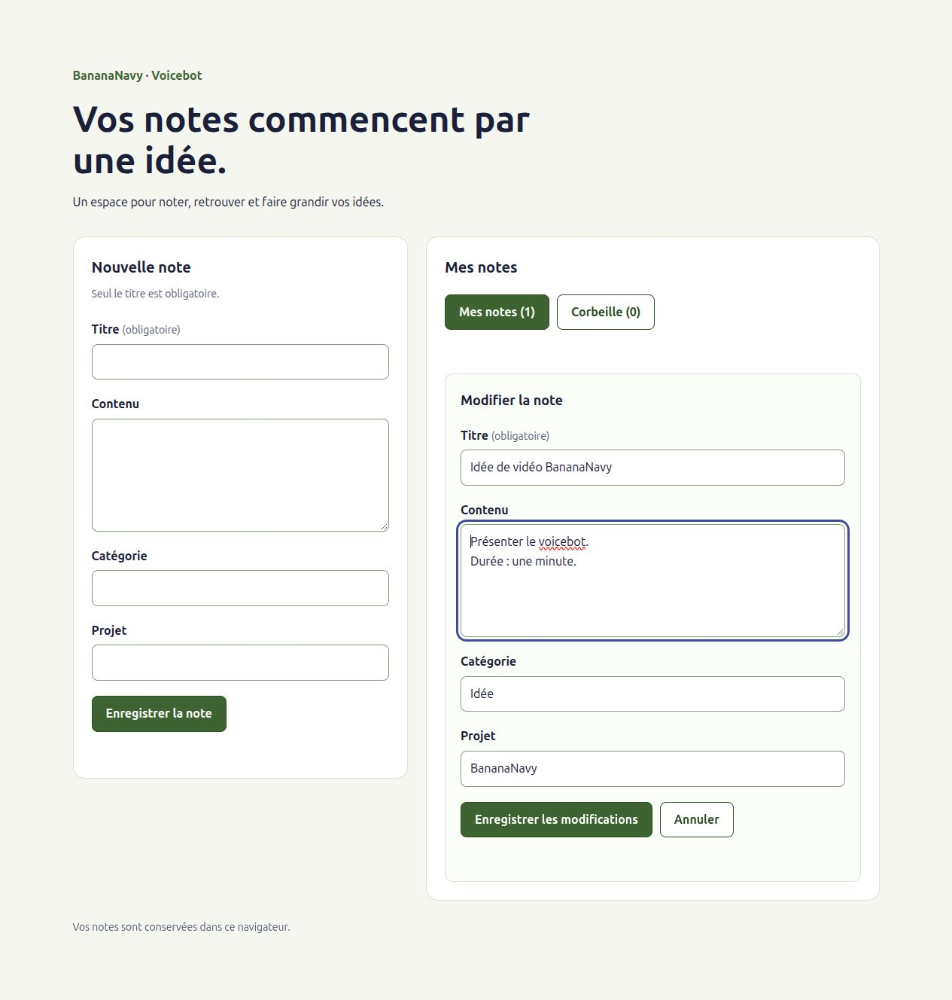

# Voicebot — BananaNavy

Application web personnelle pour gérer ses notes en parlant : création, recherche,
lecture, modification, classement, corbeille et restauration.

**État actuel :** base React + Vite, page d'accueil, modèle de note et service
IndexedDB pour enregistrer et récupérer les notes, export/import JSON validé.
Le store Context + useReducer charge les notes au démarrage et permet de les créer,
modifier, mettre en corbeille et restaurer après sauvegarde réussie. L'import via
le store actualise aussi la liste sans rechargement. L'interface permet de créer
des notes, de les consulter et modifier, de les mettre en corbeille et de les
restaurer. Les commandes de sauvegarde dans l'interface, la simulation et la
conversation vocale restent à développer.



Voir aussi [la corbeille sur mobile](docs/images/interface-corbeille-mobile.png).

## Démarrer

Prérequis : Node.js 22.12 ou plus récent et npm. Environnement initial : Node 24.16.0,
npm 11.13.0.

Depuis ce dossier :

```bash
npm ci
npm run dev
```

Ouvrir l'adresse indiquée par Vite dans le terminal. Pour arrêter : `Ctrl+C`.
Aucune clé API, aucun compte et aucune variable d'environnement ne sont nécessaires
à cette étape. Ne jamais enregistrer de secrets dans Git.

## Vérifier et compiler

```bash
npm run build
npm run preview
```

`build` compile le projet dans `dist/`. `preview` sert cette compilation localement ;
ce n'est pas un serveur de production. Dans le navigateur, créer une note avec
le formulaire, vérifier qu'elle apparaît dans la liste puis recharger la page :
la note doit être toujours visible. Voir [le guide de l'interface](docs/INTERFACE.md).

## Comprendre les fichiers

| Fichier | Rôle |
| --- | --- |
| `index.html` | Document HTML français, point d'entrée et élément `root` |
| `src/main.jsx` | Monte l'application React dans `root` |
| `src/App.jsx` | Assemble formulaire, liste et messages d'état |
| `src/components/NoteForm.jsx` | Champs partagés pour la création et la modification |
| `src/components/NotesList.jsx` | Liste de notes ou état vide adapté à la vue |
| `src/components/NoteCard.jsx` | Présentation, édition, mise en corbeille et restauration |
| `src/styles.css` | Styles communs et adaptation à la largeur de l'écran |
| `src/utils/note.js` | Création, règles de modification et de corbeille |
| `src/services/notesStorage.js` | Ouvre IndexedDB, enregistre et récupère les notes |
| `src/services/notesBackup.js` | Prépare un fichier JSON et valide les notes à importer |
| `src/stores/` | État partagé, chargement et actions de gestion des notes |
| `vite.config.js` | Active le plugin React de Vite |
| `package.json` | Commandes et dépendances |
| `package-lock.json` | Versions résolues pour une installation reproductible |
| `api/` | Emplacement documenté de la future fonction Vercel |
| `docs/` | Démarche, journal et suivi des tâches |

Pour le moment : `index.html` → `main.jsx` → `NotesProvider` → `App` → affichage.
Le provider charge les notes depuis IndexedDB ; `App` sélectionne les notes
actives et les affiche des plus récentes aux plus anciennes.

L'organisation reprend les habitudes des projets Vue de l'utilisateur :
`components`, `data`, `services`, `stores`, `utils`, et selon les besoins de
navigation `pages`, `views`, `router`. Les dossiers sont créés lorsqu'ils deviennent
utiles. `utils/note.js` contient les fonctions métier des notes ; aucun dossier
`models` n'est utilisé.

## Modèle de note

La fonction `creerNote` de `src/utils/note.js` construit un objet en mémoire.
Elle est indépendante de React et ne réalise aucune sauvegarde.

| Champ | Règle à la création |
| --- | --- |
| `id` | UUID généré automatiquement, indépendant du titre |
| `titre` | Texte obligatoire, espaces de début et de fin retirés ; titre vide refusé |
| `contenu` | Texte conservé tel quel, vide par défaut |
| `categorie` | Texte facultatif, espaces de début et de fin retirés |
| `projet` | Texte facultatif, espaces de début et de fin retirés |
| `createdAt` | Date de création au format ISO en UTC |
| `updatedAt` | Même date que `createdAt` à la création |
| `deletedAt` | `null` pour une note active ; date de mise en corbeille sinon |

Les valeurs fournies sont des chaînes de caractères. Deux notes peuvent avoir
le même titre ; leur identifiant les distingue. Les fonctions de préparation de
modification, suppression et restauration préservent `id` et `createdAt`, et
actualisent `updatedAt` uniquement pour une opération qui change réellement la note.

Exemple à exécuter depuis ce dossier, sans interface ni service externe :

```bash
node --input-type=module <<'JS'
import { creerNote } from './src/utils/note.js'

const note = creerNote({
  titre: '  Idée de vidéo BananaNavy  ',
  contenu: 'Présenter le projet en trente secondes.',
  categorie: 'Idée',
  projet: 'BananaNavy',
})

console.log(note)
JS
```

Le titre affiché doit être nettoyé, les deux dates identiques et `deletedAt` égal
à `null`. Un titre composé uniquement d'espaces provoque l'erreur
« Le titre de la note est obligatoire. ».

## Stockage local IndexedDB

`src/services/notesStorage.js` utilise directement l'API du navigateur, sans
bibliothèque supplémentaire. La base `voicebot`, version 1, contient un magasin
`notes` dont la clé est le champ `id`.

- `ouvrirBase()` crée la structure à la première ouverture et renvoie une connexion.
  Si vous l'appelez directement, fermez cette connexion avec `base.close()`.
- `enregistrerNote(note)` ajoute ou remplace une note complète selon son `id`.
  La promesse est résolue uniquement après la fin réussie de la transaction.
- `recupererNotes()` renvoie toutes les notes, y compris celles de la future
  corbeille, sans tri de présentation. Une base vide renvoie `[]`.
- `fusionnerNotes(notes)` ajoute un ensemble de notes préalablement validées dans
  une seule transaction et conserve toutes les notes dont l'identifiant existe
  déjà localement. Cette fonction est utilisée par le service d'import.

Les deux dernières fonctions ouvrent et ferment elles-mêmes leur connexion.
Les erreurs sont propagées à l'appelant, qui pourra les afficher dans l'interface.
Une ouverture bloquée signale de fermer les autres onglets ; une connexion ouverte
est libérée lorsqu'un autre onglet demande un changement de version.

Le service reçoit des notes complètes construites avec `creerNote`. Il ne valide
pas encore les données externes et ne modifie pas `updatedAt` ou `deletedAt` : les
règles métier sont gérées par les utilitaires appelés par le store, et l'import
possède sa propre validation.

### Vérification manuelle dans le navigateur

Démarrer `npm run dev`, ouvrir l'application puis la console des outils de
développement. Exécuter sur une ligne ou en un seul bloc :

```js
const { creerNote } = await import('/src/utils/note.js')
const { enregistrerNote, recupererNotes } = await import('/src/services/notesStorage.js')
const note = creerNote({ titre: 'Essai de persistance BananaNavy' })
await enregistrerNote(note)
await enregistrerNote({ ...note, contenu: 'Toujours présente après rechargement.' })
console.table(await recupererNotes())
```

La note doit apparaître une seule fois, avec le contenu ajouté. Recharger la page,
puis exécuter :

```js
const { recupererNotes } = await import('/src/services/notesStorage.js')
console.table(await recupererNotes())
```

La même note doit être présente. Les imports de `/src/` ci-dessus sont destinés au
serveur de développement Vite. On peut aussi consulter `voicebot` → `notes` dans
le panneau de stockage IndexedDB des outils de développement.

Garder exactement la même origine (protocole, hôte et port) pour les deux essais :
`localhost` et `127.0.0.1`, ou deux ports différents, ont des stockages distincts.
Ces essais créent de vraies notes locales. Recharger la page après une écriture
directe par le service pour les relire et les afficher dans l'interface.

Vérifications effectuées le 8 novembre 2026 dans un profil Chrome temporaire :
création, remplacement sans doublon, conservation des notes de la corbeille,
persistance après redémarrage du navigateur et rechargement, erreurs de lecture
et d'écriture lors de transactions annulées, changement de version. Voir le
[journal](docs/JOURNAL.md) pour le détail et les limites des essais.

## Export et import JSON

`src/services/notesBackup.js` expose deux fonctions :

- `exporterNotes()` renvoie un objet `File` JSON en mémoire, nommé
  `voicebot-notes-AAAA-MM-JJ.json`. Il contient la version 1 du format, la date
  d'export et toutes les notes, corbeille comprise. Il ne déclenche pas de
  téléchargement automatique.
- `importerNotes(fichier)` lit un `File` ou `Blob`, valide le JSON et toutes les
  notes, puis ajoute uniquement les identifiants absents de la base. Le résultat
  est `{ importees, ignorees }`. Les notes locales sont conservées intégralement,
  même si le fichier porte une autre version de leur contenu.

Un fichier invalide est refusé avant toute ouverture de la base. Les identifiants
répétés dans le même fichier sont refusés. Une erreur pendant la transaction
annule l'ensemble des ajouts. Identifiants, textes, dates et état de corbeille sont
préservés ; seuls les champs connus sont retenus.

Les boutons de téléchargement et de sélection de fichier ne sont pas encore
implémentés. Voir [le guide des sauvegardes](docs/SAUVEGARDES.md) pour les règles,
les exemples dans la console et les vérifications effectuées.

## Architecture prévue

- React + Vite : interface et outils de développement.
- Context + useReducer : centralisation des notes et des actions.
- IndexedDB : persistance locale, sans base distante.
- SDK React ElevenLabs et client tools : conversation et actions dans le navigateur.
- Vercel : hébergement et fonction serveur pour les jetons de conversation.

Flux cible : parole → agent → client tool → store → IndexedDB → confirmation à l'agent.
La confirmation de réussite devra attendre la sauvegarde effective.

La configuration ElevenLabs, le mode de simulation et le déploiement seront
documentés lorsqu'ils seront implémentés. Aucun service payant n'est activé.

## Store des notes

`NotesProvider`, installé dans `main.jsx`, rend le store accessible à tous ses
composants enfants. Le hook `useNotes()` expose :

- `notes` : toutes les notes chargées, corbeille comprise ;
- `chargement` : vrai pendant la lecture initiale, faux après réussite ou échec ;
- `erreur` : message de la dernière erreur gérée, ou `null` ;
- `rechargementRequis` : vrai si une lecture a échoué et que les actions sont
  bloquées jusqu'au rechargement de l'application ;
- `ajouterNote(champs)` : construit une note, attend sa sauvegarde puis demande
  au reducer de l'ajouter en mémoire. Renvoie la note sauvegardée ou rejette
  la promesse en cas d'erreur.
- `modifierNote(id, changements)` : modifie uniquement `titre`, `contenu`,
  `categorie` ou `projet` sur une note active.
- `supprimerNote(id)` : place la note en corbeille sans la retirer du stockage.
- `restaurerNote(id)` : remet une note de la corbeille à l'état actif.
- `importerSauvegarde(fichier)` : importe le fichier puis relit IndexedDB et
  actualise le store dans la même file d'actions. Renvoie `{ importees, ignorees }`.

Les actions sont refusées avant un chargement réussi. Si la lecture initiale
échoue, recharger la page après avoir résolu le problème. Une erreur d'action
conserve les notes existantes et permet de réessayer. Les actions sont exécutées
dans l'ordre pour préserver les changements de demandes rapprochées.

Si l'import est enregistré mais que sa relecture échoue, l'erreur l'indique
explicitement, conserve les compteurs dans `resultatImport` avec
`importEnregistre: true`, et impose un rechargement avant toute autre action.
Un fichier refusé ou une transaction d'import annulée ne bloque pas le store.

Un identifiant introuvable, un titre vide ou un champ non autorisé provoque une
erreur. Une note en corbeille doit être restaurée avant modification. Supprimer
une note déjà supprimée, restaurer une note active ou appliquer une modification
équivalente ne provoque ni écriture ni changement de date.

Le reducer est indépendant de React et du stockage : il calcule les nouveaux
états sans modifier les précédents. Voir [le guide du store](docs/STORE.md) pour
les responsabilités des fichiers, le flux et les vérifications.

## Démarche et présentation

Voir [la démarche](docs/DEMARCHE.md), [le journal](docs/JOURNAL.md) et
[le suivi](docs/SUIVI.md). Le [cadrage initial](../PROJET.md) et
[l'étude ElevenLabs](../ELEVENLABS-COUTS.md) restent les références.

L'IA accompagne les propositions de code et la documentation ; l'utilisateur
s'approprie les choix et vérifie les résultats pour pouvoir présenter le projet.

Pour chaque étape, le code est expliqué avant modification et mis en place
uniquement après le **go de l'utilisateur**. Les vérifications et leur résultat
sont ensuite expliqués.

Lorsqu'un ensemble cohérent est prêt, proposer un message de commit au format
**VERBE EN MAJUSCULES + description en français**, par exemple
`ADD sauvegarde locale des notes avec IndexedDB`.

Le dépôt Git est à la racine de `voicebot`. Chaque grosse fonctionnalité est
développée sur une branche `feature/...` issue de `dev`, avec plusieurs étapes
et éventuellement plusieurs commits. L'utilisateur réalise les commits, les push,
les pull requests et les merges. Les fonctionnalités terminées et testées sont
intégrées dans `dev`, puis une V1 acceptable dans `main` pour la présentation.
La branche `feature/gestion-notes` regroupe le modèle, le stockage et le store.

## Interface de gestion des notes

Le formulaire propose titre, contenu, catégorie et projet. Seul le titre est
obligatoire. Les champs sont conservés localement dans `NoteForm` pendant la
saisie ; une soumission appelle `ajouterNote` du store. Après sauvegarde réussie,
la nouvelle note apparaît, les champs sont vidés et une confirmation est affichée.
En cas d'erreur, la saisie reste disponible et le message du store est affiché.

Le formulaire est désactivé pendant le chargement, la sauvegarde ou lorsqu'un
rechargement est requis. Un verrou empêche les soumissions simultanées. Une erreur
de lecture affiche un bouton de rechargement. Les retours à la ligne des notes
sont préservés.

Chaque note active propose « Modifier » et « Mettre en corbeille ». L'édition
ouvre le formulaire prérempli dans la carte ; « Annuler » abandonne la saisie sans
modifier la note. Un échec garde le formulaire et son brouillon. Les identifiants
des champs sont propres à chaque formulaire grâce à `useId`.

Les boutons « Mes notes » et « Corbeille » affichent leurs compteurs et changent
la vue. Les notes en corbeille proposent uniquement « Restaurer » et affichent
leur date de mise en corbeille. Les actions attendent la sauvegarde avant de
déplacer les cartes et d'annoncer leur réussite. Aucune suppression définitive
n'est proposée. Les listes restent montées : un brouillon d'édition est conservé
lors d'un aller-retour entre les vues, tant que la page n'est pas rechargée.

La disposition utilise deux colonnes sur ordinateur et une seule jusqu'à 760 px.
Les champs sont étiquetés, le focus clavier est visible et les confirmations et
erreurs utilisent des régions accessibles. Voir [le guide de l'interface](docs/INTERFACE.md)
pour le scénario de vérification et les limites.

## Limites et suite

Création, lecture, modification et corbeille sont disponibles depuis la page.
Aucun microphone n'est sollicité. Les boutons d'export/import restent à ajouter.
Le mode de simulation vocale, le scénario final complet et le lien public
seront ajoutés plus tard. Les captures actuelles utilisent une note de démonstration
sans données personnelles.

À terme, les notes resteront propres au navigateur et à l'appareil, sans
synchronisation. L'export/import permet une sauvegarde manuelle. Les informations
transmises à l'agent vocal passeront par ElevenLabs.
