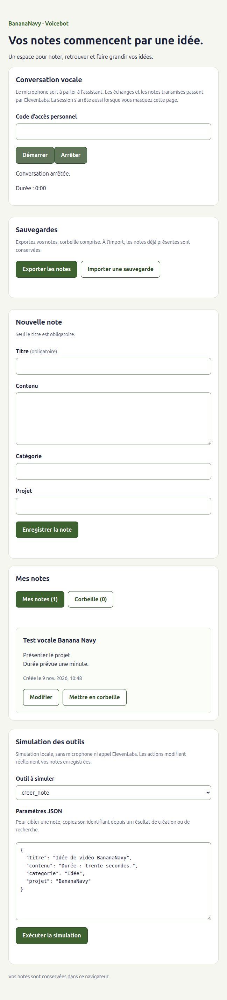

# Démontrer BananaNavy V1

Ce guide propose une démonstration courte et un parcours de secours sans voix.
Les résultats constatés le 9 novembre 2026 sont séparés des essais à réaliser.

## Préparer la présentation

1. Ouvrir [la version de test](https://project-bxwwf.vercel.app) dans le navigateur
   habituel. Garder cette origine : les notes sont propres au navigateur et à
   l’appareil, sans synchronisation. Un téléphone ne récupère pas les notes du PC.
2. Exporter les notes utiles avant de commencer. Utiliser uniquement des exemples
   sans données personnelles : les échanges et les notes lues passent par ElevenLabs.
3. Vérifier que le code personnel est disponible en privé. Ne montrer ni le fichier
   `.env.local`, ni la clé API, ni le code dans une capture ou une présentation.
4. Vérifier la validité de la clé serveur et le quota avant une présentation future.
   La clé d’essai du 9 novembre expire après un jour. Le solde relevé avant les
   premiers essais n’est pas le solde actuel. Aucun abonnement payant nécessaire
   au parcours local ; ne pas activer de dépassement ou de recharge pour la démo.
5. Garder la page visible et limiter chaque conversation à moins de deux minutes.
   Le masquage de la page demande aussi l’arrêt. Attendre la réponse après chaque
   consigne et cliquer Arrêter en fin d’essai.

Le commit applicatif `1667550`, avec la disposition à deux colonnes, est déployé
en Production depuis le 9 novembre à 11 h 50. Les essais des six outils vocaux
ont précédé cette réorganisation visuelle ; aucune nouvelle conversation ensuite. La livraison stable sur la branche Git `main` reste une étape distincte.
La voix est ouverte uniquement en Production, protégée par un code personnel.

## Expliquer le projet en trente secondes

« BananaNavy permet de gérer ses notes à la voix. L’agent comprend la demande et
appelle un outil dans le navigateur. React met à jour les notes après leur sauvegarde
dans IndexedDB, puis l’outil confirme le résultat à l’agent. Les notes restent sur
cet appareil. La clé ElevenLabs reste sur le serveur, qui fournit un accès temporaire
après vérification du code personnel. »

La [description de l’architecture](../README.md#architecture) détaille ce flux.

## Parcours vocal à présenter

Choisir un titre de démonstration absent des notes, par exemple « Démo vidéo
BananaNavy ». Si ce titre existe, choisir un autre titre et l’utiliser dans toutes
les consignes. Chaque demande de création peut créer une nouvelle note.

### Première conversation : créer et corriger

Saisir le code personnel et cliquer Démarrer. Attendre chaque confirmation.

| Consigne proposée | Résultat à observer |
| --- | --- |
| « Crée une note intitulée Démo vidéo BananaNavy, avec le contenu Présenter le projet. » | Une nouvelle note apparaît avec ce titre et ce contenu |
| « Ajoute à cette note : Durée prévue, trente secondes. Conserve le contenu existant. » | La première phrase reste présente et la durée est ajoutée |
| « Remplace seulement trente secondes par une minute. » | Le texte initial est préservé et seule la durée change |

Cliquer Arrêter, puis recharger. La note doit rester présente avec une minute.
La transcription temporaire disparaît : ce comportement est prévu.

### Deuxième conversation : retrouver et restaurer

Redémarrer avec le code personnel et attendre chaque réponse.

| Consigne proposée | Résultat à observer |
| --- | --- |
| « Retrouve la note Démo vidéo BananaNavy et lis son contenu. » | L’agent retrouve la note et lit le texte complet, dont la durée corrigée |
| « Mets cette note dans la corbeille. » | Le compteur des notes actives diminue et celui de la corbeille augmente |
| « Retrouve cette note dans la corbeille et restaure-la. » | La note revient dans les notes actives, avec son contenu intact |

Cliquer Arrêter et recharger pour vérifier l’état final. La suppression est
réversible ; l’application ne propose pas de suppression définitive.

## Preuves déjà obtenues

Le même ensemble d’actions a été exercé sur « Test vocale Banana Navy », sans
recréer une note pour reproduire le titre du scénario ci-dessus :

- Création vocale : 17 secondes, puis note retrouvée après rechargement à 10 h 49.
- Recherche, lecture, ajout et remplacement : 50 secondes, puis texte conservé
  après rechargement : « Présenter le projet » et « Durée prévue une minute. ».
- Nouvelle conversation de 30 secondes : mise en corbeille et restauration,
  transitions des compteurs confirmées par l’utilisateur ; note et contenu
  retrouvés après rechargement, une note active et aucune en corbeille.
- Disposition à 390 × 844 px et refus de codes invalides inspectés, sans nouvelle
  conversation. Ce contrôle de largeur ne valide pas le microphone d’un téléphone.

[Capture à largeur mobile](images/validation-vocale-mobile.jpg).

## Parcours de secours sans voix

Si l’accès vocal échoue, arrêter l’essai et présenter la gestion locale ou le
[simulateur](SIMULATION.md#scénario-de-démonstration-reproductible).
Dans la nouvelle disposition, le déplier avec « Ouvrir le simulateur » sous la
conversation. La disposition est publiée depuis le 9 novembre à 11 h 50.
Il utilise les mêmes outils, validations, store et transactions IndexedDB.
Annoncer clairement qu’il s’agit d’appels simulés, sans conversation ni microphone.
Les modifications des notes sont réelles ; utiliser des notes de démonstration.

Le simulateur permet de créer, rechercher, lire, modifier, mettre en corbeille et
restaurer sans code d’accès ni crédit ElevenLabs. Le formulaire et les sauvegardes
JSON restent aussi disponibles. Une connexion réseau est nécessaire pour charger
le site ; un fonctionnement hors ligne complet n’est pas garanti.

## Réagir aux erreurs

- Code invalide : vérifier sa saisie en privé ; ne jamais utiliser la clé API à sa place.
- Trop de demandes : attendre au moins une minute avant un nouvel essai, sans
  relance en boucle. La règle Vercel autorise deux demandes/minute/IP.
- Accès indisponible ou échec du jeton : vérifier côté serveur la clé, son échéance,
  les permissions et les quotas ; ne pas déplacer la clé dans le navigateur.
- Résultat incertain : arrêter et regarder les notes avant toute nouvelle mutation.
  Une nouvelle création automatique pourrait créer un doublon.
- Problème de microphone : vérifier les permissions du site et du navigateur.
  Ne pas confondre le contrôle de largeur mobile avec un essai audio réel.

## Recette complémentaire à réaliser

| Essai | Critère de réussite | État au début de la recette |
| --- | --- | --- |
| Deux titres proches | L’agent demande une précision avant une mutation ambiguë | À vérifier vocalement |
| Classement | Seuls catégorie et projet changent, titre et contenu conservés | À vérifier vocalement |
| Téléphone physique | Conversation, note persistante et arrêt lors du masquage | Reporté à la demande de l’utilisateur pour préserver les crédits ; disposition seule vérifiée |
| Contenu contenant des consignes | L’agent traite la note comme une donnée | À vérifier vocalement |
| Échec de sauvegarde en conversation | Aucune réussite annoncée si la sauvegarde échoue | Tests locaux existants ; cas vocal réel non exercé |

La limite configurée de cinq conversations/jour et la clé expirante demandent
de réserver les essais réels aux contrôles utiles. Les protections du serveur
et les limites connues sont décrites dans le [guide agent](AGENT-ELEVENLABS.md)
et le [guide API](../api/README.md).

Le 9 novembre, l’utilisateur choisit de reporter le test audio sur téléphone en
raison de la consommation de crédits observée. Aucune conversation supplémentaire
n’est lancée pour la préparation de ce guide. Ce report laisse le fonctionnement
audio mobile non vérifié, sans remettre en cause le parcours ordinateur observé.
