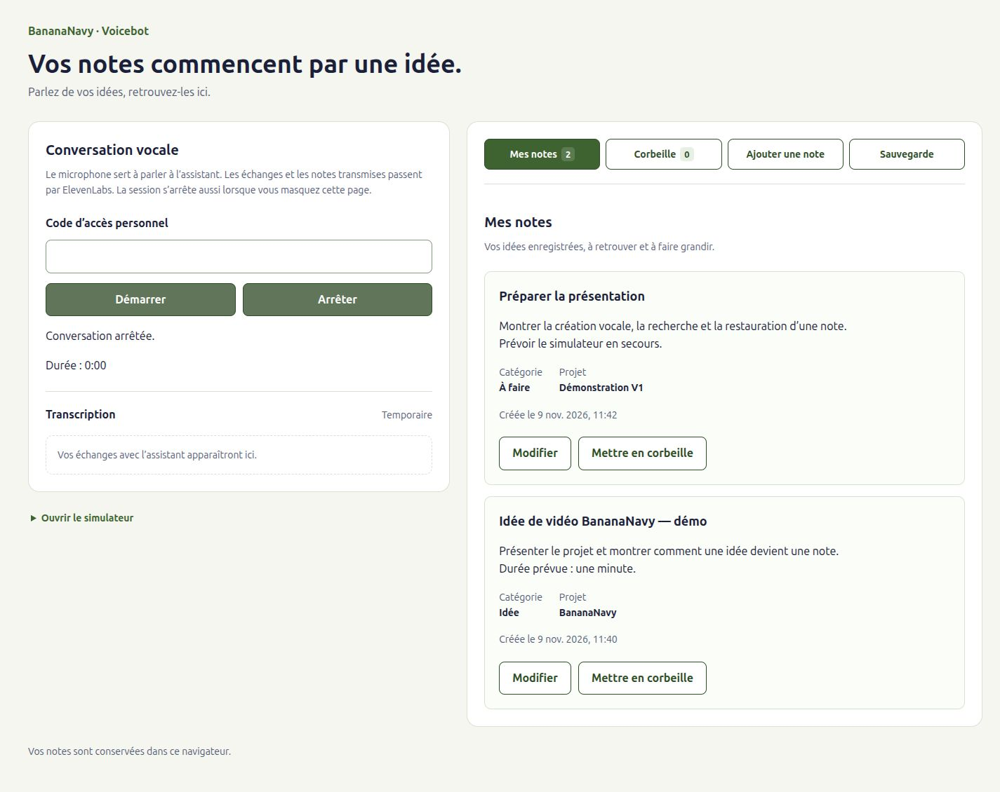
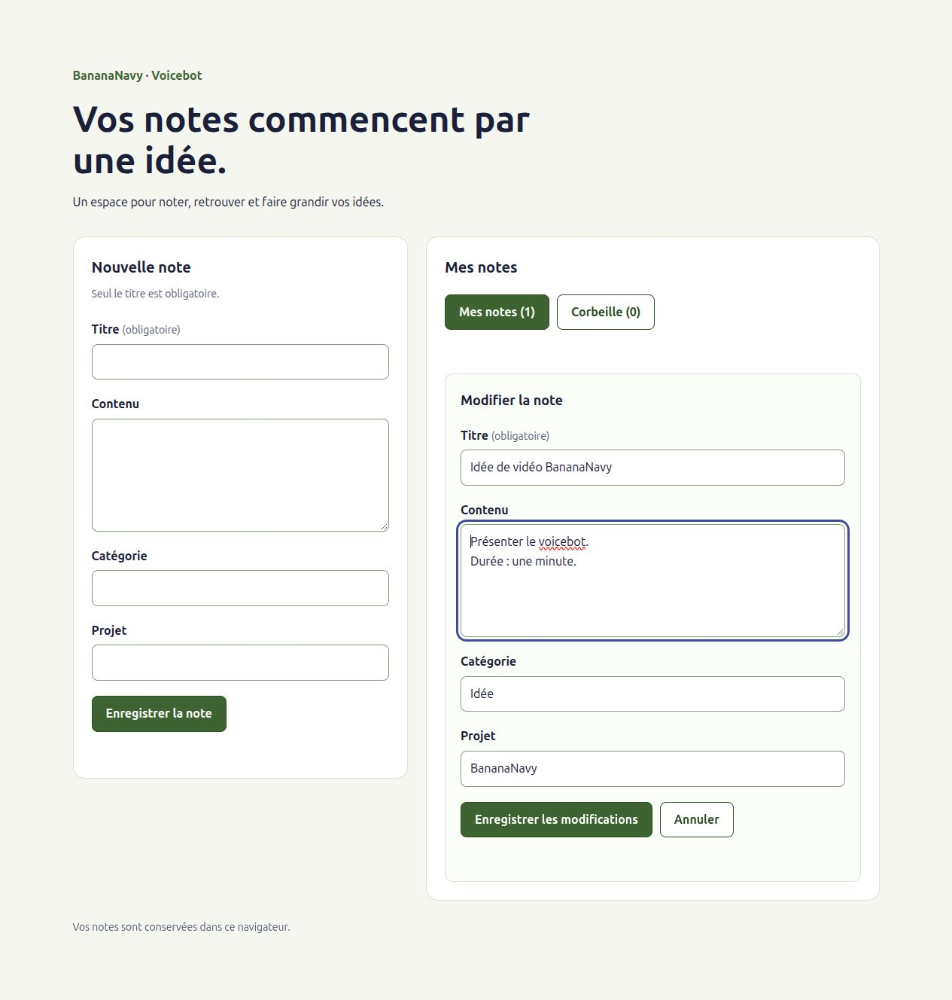

# Interface — création, lecture, modification et corbeille

## Disposition à deux espaces — 9 novembre 2026

La conversation et sa transcription temporaire occupent la colonne de gauche.
Le lien dépliant « Ouvrir le simulateur » donne accès aux outils de démonstration.
À droite, quatre boutons sélectionnent Mes notes, Corbeille, Ajouter une note
ou Sauvegarde. Les deux premiers affichent les compteurs issus du store.

Le changement de vue ne démonte ni la conversation ni les panneaux de droite.
Les brouillons de création et d’édition sont conservés, mais pas après rechargement.
Après création réussie, `onEnregistre` ramène aux notes et le focus revient sur
leur bouton de navigation. En cas d’échec, le formulaire reste visible avec la saisie.
La transcription défile au-delà de 360 px ; sa zone peut recevoir le focus clavier.

Cette disposition est vérifiée localement et reste à déployer. Les preuves vocales
de la version publiée demeurent distinctes : aucun nouvel appel ElevenLabs n’a
été lancé pour ce changement.

[Disposition mobile](images/interface-deux-colonnes-mobile.jpg).

## Responsabilités des composants

| Fichier | Rôle |
| --- | --- |
| `App.jsx` | Sélectionne les vues, trie les notes, affiche états et confirmations |
| `components/NoteForm.jsx` | Champs partagés, brouillon de création ou de modification |
| `components/NotesList.jsx` | Affiche les cartes ou un message de liste vide |
| `components/NoteCard.jsx` | Présentation, édition, mise en corbeille et restauration |
| `components/NotesBackup.jsx` | Téléchargement, sélection de fichier et compteurs d'import |
| `components/ToolsSimulator.jsx` | Sélection d'outil, paramètres et dernier résultat JSON |
| `styles.css` | Présentation commune, focus, états et adaptation mobile |

`App` filtre sur `deletedAt === null`, puis trie par date de création décroissante.
Le tri porte sur la nouvelle liste produite par `filter`, sans modifier le store.
La clé React de chaque carte est l'identifiant de sa note.
La corbeille est filtrée sur `deletedAt !== null` et triée par date de mise en
corbeille décroissante.

## Saisie locale et données partagées

Les champs du formulaire sont contrôlés : `value` vient de l'état local React,
et `onChange` met cet état à jour. Ils ne modifient pas les notes du store pendant
la saisie. La soumission empêche la navigation HTML classique avec `preventDefault`,
puis appelle `ajouterNote(champs)`.

L'état local `sauvegarde` change le libellé du bouton et désactive le `fieldset`.
Une référence `soumissionEnCours` bloque aussi deux événements arrivant avant le
prochain rendu. Le formulaire est également désactivé lorsque le store charge
ou signale `rechargementRequis`.

Après réussite, vider les champs et afficher « Note enregistrée. ». En cas
d'échec, conserver la saisie ; `App` affiche le message du store avec `role="alert"`.
Un titre absent est bloqué par la validation native `required` ; un titre composé
d'espaces est refusé par la règle métier du store.

## Lecture et états

La carte affiche le texte sans interpréter de HTML, avec les retours à la ligne
préservés par `white-space: pre-wrap`. La catégorie et le projet sont affichés
lorsqu'ils sont renseignés. La date de création utilise le format français et
le fuseau du navigateur, avec sa valeur ISO dans l'élément `time`.

- Chargement : message de progression et formulaire indisponible.
- Liste vide après lecture réussie : invitation à créer une première note.
- Erreur d'action : message explicite, notes conservées et saisie réutilisable.
- Rechargement requis : formulaire bloqué et bouton « Recharger la page ».
  Une lecture échouée ne se présente pas comme une liste vide réussie.

Les vues « Mes notes » et « Corbeille » possèdent des boutons avec compteurs et
`aria-pressed`. Ce sont des boutons de sélection de vue, pas un composant d'onglets
ARIA nécessitant des raccourcis supplémentaires. La corbeille vide possède son
propre message.

## Modification et corbeille

`NoteForm` accepte une `note` facultative. En création, les champs commencent
vides et la soumission appelle `ajouterNote`. En édition, ils sont initialisés
depuis la note et appellent `modifierNote(note.id, champs)`. Le même composant
contient les étiquettes, la validation native, le verrou et les champs.

Chaque instance utilise `useId` comme préfixe de ses identifiants de champs : le
formulaire de création et un ou plusieurs formulaires d'édition peuvent coexister
sans collision des attributs `id`/`htmlFor`.

`NoteCard` conserve son état `edition`. Le bouton Modifier remplace sa présentation
par le formulaire prérempli. Annuler ferme ce formulaire sans sauvegarde. Après
succès, le callback `onEnregistre` ferme l'édition et annonce « Note modifiée. ».
Après erreur, le formulaire reste ouvert et sa saisie est conservée.

Pour la corbeille, la carte appelle `supprimerNote` ou `restaurerNote` selon son
état. Le verrou bloque les appels rapprochés ; les boutons sont indisponibles
pendant l'action, le chargement ou lorsqu'un rechargement est requis. Le texte
indique « Mise en corbeille… » ou « Restauration… » pendant l'opération. Aucune
suppression définitive n'est ajoutée.

Le callback `onConfirmer`, transmis par `NotesList`, remonte à `App`. La confirmation
est annoncée après le retour réussi du store. Elle reste donc visible même si la
carte vient de quitter la liste sélectionnée.

Les deux listes restent montées avec `hidden` sur la vue inactive. Cela préserve
le brouillon d'une carte lorsque l'utilisateur change de vue puis revient, sans
le rendre accessible dans la vue masquée. Un rechargement de page perd les
brouillons non enregistrés. Les listes vides et confirmations reflètent le store.

## Protection des éditions concurrentes

Le formulaire conserve avec `useRef` les quatre valeurs présentes à son ouverture.
Cette référence ne change pas lorsqu'un outil met la note à jour pendant la saisie.
`preparerChangementsEdition` compare le brouillon à ces valeurs et renvoie uniquement
les champs réellement modifiés, après nettoyage des textes hors contenu.

Le formulaire transmet ces changements et ses valeurs initiales à `modifierNote`.
La vérification se fait dans la file du store sur sa dernière note connue :

- Champs distincts : appliquer les changements du formulaire et conserver ceux de l'outil.
- Même champ modifié différemment : refuser toute la sauvegarde, garder le brouillon
  et indiquer de le copier avant d'annuler et rouvrir la note.
- Valeur du brouillon déjà identique à la dernière valeur : autoriser l'opération,
  qui reste sans écriture si aucun autre champ ne change.

Une édition sans changement ne réenregistre donc pas une ancienne version. Après
un conflit, annuler puis rouvrir initialise un nouveau brouillon depuis la note
récente. Cette protection ne synchronise pas les modifications d'autres onglets.

Vérifications de non-régression : six scénarios Node dans `tests/noteEdition.test.js`,
complétés dans le navigateur sur la compilation de production. Le scénario
initial titre manuel/contenu du simulateur conserve les deux valeurs après
rechargement. Un conflit sur le contenu refuse aussi le titre modifié dans le même
brouillon : aucune sauvegarde partielle. Le brouillon reste ouvert et une édition
après annulation/réouverture réussit.

## Présentation et accessibilité

Le panneau « Simulation des outils » replié à gauche appelle la couche commune
sans microphone ni réseau. Ses actions sur les notes sont réelles et annoncées
comme telles. Le sélecteur et la zone JSON possèdent des étiquettes, le résultat
est associé au nom de l'outil et possède une zone défilable accessible au clavier.
Voir [SIMULATION.md](SIMULATION.md) pour le scénario et les contrôles effectués.

Le panneau Sauvegardes propose désormais l'export JSON et la sélection d'une
sauvegarde à importer, avec compteurs et messages. Il réutilise les services et
le store et s’ouvre via « Sauvegarde » dans la navigation de droite. Voir
[le guide des sauvegardes](SAUVEGARDES.md) pour le fonctionnement et les essais.

Conserver les couleurs initiales de BananaNavy : fond crème, texte bleu foncé et
accent vert. Disposition en deux colonnes sur ordinateur, une colonne jusqu'à
900 px. Les cartes et les titres peuvent couper les chaînes longues pour ne pas
déborder sur les petits écrans.

Les champs possèdent des étiquettes associées, le bouton une hauteur minimale de
44 px et les contrôles un contour de focus visible. La confirmation utilise
`role="status"`, les erreurs `role="alert"` et les opérations `aria-busy`.
Une vérification complète avec lecteur d'écran reste à réaliser.

## Démonstration manuelle reproductible

1. Lancer `npm run dev` et ouvrir l'adresse donnée par Vite.
2. Choisir « Ajouter une note », puis créer la note « Idée de vidéo BananaNavy », contenu « Présenter le voicebot et
   ses premières notes. », puis sur une nouvelle ligne « Durée : trente secondes. ».
   Catégorie : « Idée » ; projet : « BananaNavy ».
3. Vérifier le retour aux notes, la carte, les informations et la confirmation.
   Rouvrir « Ajouter une note » pour constater que les champs sont vidés.
4. Recharger la page : la note doit rester visible.
5. Ouvrir « Ajouter une note » et soumettre un titre composé d'espaces : vérifier le message et la conservation
   du formulaire. Corriger le titre puis enregistrer.
6. Réduire la fenêtre : conversation puis espace de notes doivent s’empiler sans déborder.
7. Cliquer sur Modifier : vérifier les champs préremplis. Modifier le contenu et
   annuler ; rouvrir pour vérifier que la note d'origine est conservée.
8. Remplacer la durée par une minute, enregistrer et recharger : la modification
   doit être conservée.
9. Mettre en corbeille, ouvrir cette vue et recharger : la note doit y rester.
10. Restaurer puis recharger : la note doit revenir dans Mes notes.

Ces actions créent des notes réelles dans le navigateur et sur l'origine utilisés.

## Vérifications du 8 novembre 2026

Compilation réussie. Essais sur la compilation réelle dans Chrome, avec un profil
temporaire isolé et une origine locale :

- Liste vide, titre obligatoire, titre composé d'espaces refusé.
- Saisie par événements clavier, contenu exact et retours à la ligne conservés,
  informations nettoyées et affichées, confirmation et champs vidés après succès.
- Note retrouvée après rechargement puis redémarrage du navigateur ; fixture de
  corbeille absente de la liste active ; notes récentes en premier.
- Transaction d'écriture annulée : message visible, formulaire conservé, aucune
  note fantôme et nouvelle tentative réussie.
- Confirmation de transaction retardée : champs bloqués, bouton en progression,
  événements de soumission supplémentaires sans doublon.
- Texte ressemblant à du HTML affiché littéralement ; titre très long sans
  débordement horizontal à 320 px.
- Rendu contrôlé à 1280, 390 et 320 px ; captures ordinateur et mobile inspectées.
- Lecture initiale annulée : erreur distincte d'une liste vide, formulaire bloqué,
  bouton de rechargement rétablissant l'affichage après suppression de l'erreur simulée.
- Étiquettes présentes pour tous les champs ; aucune exception navigateur non gérée.

L'aperçu Vite a aussi été ouvert dans le navigateur intégré et son état vide
vérifié. Les captures ci-dessous proviennent du profil de test isolé, avec une
note de démonstration sans données personnelles :

[Interface mobile](images/interface-notes-mobile.png)

Les autres navigateurs, les lecteurs d'écran et l'épuisement réel du quota de
stockage restent à vérifier. La voix n'est pas connectée.

## Vérifications complémentaires — édition et corbeille

Compilation réussie. Parcours dans le navigateur intégré sur une origine locale
de test dédiée, avec uniquement une note de démonstration :

- Création puis édition : champs préremplis, contenu original conservé après
  annulation, validation d'un titre composé d'espaces avec brouillon conservé.
- Aller-retour dans la corbeille sans perte du brouillon d'édition ; sauvegarde
  d'une durée d'une minute retrouvée après rechargement.
- Mise en corbeille, compteurs et confirmation ; persistance après rechargement,
  date de mise en corbeille, absence de commandes Modifier dans cette vue.
- Restauration, confirmation et retour à la liste active après rechargement.
- Identifiants de champs uniques avec les formulaires de création et d'édition
  simultanés ; navigation Tab du titre vers le contenu.
- Rendu vérifié à 1280 et 390 px, sans débordement à 320 px ; captures inspectées.

Les erreurs IndexedDB forcées des actions restent couvertes par les essais
antérieurs du store. Cette étape n'a pas répété leur injection dans l'interface :
la conservation du brouillon a été vérifiée avec un refus de validation réel.

[Modification sur mobile](images/interface-edition-mobile.png) ·
[Corbeille sur ordinateur](images/interface-corbeille-ordinateur.png) ·
[Corbeille sur mobile](images/interface-corbeille-mobile.png)

## Vérifications de la disposition — 9 novembre 2026

- Tests existants et compilation réussis ; aucun changement du store, des outils,
  du SDK ou de la route serveur.
- Formulaire de création ouvert à la demande, brouillon conservé après navigation
  vers Sauvegarde ; après succès, retour aux notes, confirmation et focus vérifiés.
- Formulaire réinitialisé pour la création suivante ; brouillon d’édition conservé
  lors d’un aller-retour dans la corbeille, modification et persistance vérifiées.
- Mise en corbeille puis restauration depuis les nouvelles vues ; compteurs corrects.
- Export téléchargé puis réimporté depuis Sauvegarde : zéro ajout, une note ignorée.
- Simulateur déplié, recherche locale réussie ; code fictif saisi dans le panneau
  vocal, bouton Démarrer resté disponible après navigation, puis champ vidé sans appel.
  Cela contrôle le maintien de l’état local, pas une session audio réelle.
- Contrôles à 320, 390, 900, 1024 et 1440 px : aucun débordement horizontal,
  empilement jusqu’à 900 px, deux colonnes au-delà et identifiants DOM uniques.
- Captures issues de notes créées manuellement pour cette vérification sur une
  origine locale distincte ; la version publique et ses notes ne sont pas modifiées.
