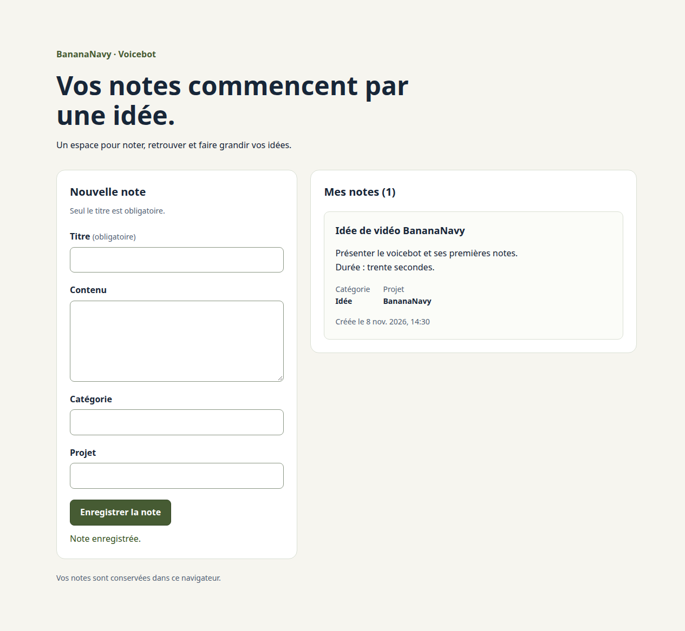

# Interface — création et lecture

## Responsabilités des composants

| Fichier | Rôle |
| --- | --- |
| `App.jsx` | Lit le store, sélectionne et trie les notes actives, affiche les états |
| `components/NoteForm.jsx` | Conserve la saisie et déclenche la création |
| `components/NotesList.jsx` | Affiche les cartes ou un message de liste vide |
| `components/NoteCard.jsx` | Présente titre, contenu, catégorie, projet et date |
| `styles.css` | Présentation commune, focus, états et adaptation mobile |

`App` filtre sur `deletedAt === null`, puis trie par date de création décroissante.
Le tri porte sur la nouvelle liste produite par `filter`, sans modifier le store.
La clé React de chaque carte est l'identifiant de sa note.

## Saisie locale et données partagées

Les champs du formulaire sont contrôlés : `value` vient de l'état local React,
et `onChange` met cet état à jour. Ils ne modifient pas les notes du store pendant
la saisie. La soumission empêche la navigation HTML classique avec `preventDefault`,
puis appelle `ajouterNote(champs)`.

L'état local `sauvegarde` change le libellé du bouton et désactive le `fieldset`.
Une référence `soumissionEnCours` bloque aussi deux événements arrivant avant le
prochain rendu. Le formulaire est également désactivé lorsque le store charge
ou signale `rechargementRequis`.

Après réussite, vider les champs et afficher « Note enregistrée. ». En cas
d'échec, conserver la saisie ; `App` affiche le message du store avec `role="alert"`.
Un titre absent est bloqué par la validation native `required` ; un titre composé
d'espaces est refusé par la règle métier du store.

## Lecture et états

La carte affiche le texte sans interpréter de HTML, avec les retours à la ligne
préservés par `white-space: pre-wrap`. La catégorie et le projet sont affichés
lorsqu'ils sont renseignés. La date de création utilise le format français et
le fuseau du navigateur, avec sa valeur ISO dans l'élément `time`.

- Chargement : message de progression et formulaire indisponible.
- Liste vide après lecture réussie : invitation à créer une première note.
- Erreur d'action : message explicite, notes conservées et saisie réutilisable.
- Rechargement requis : formulaire bloqué et bouton « Recharger la page ».
  Une lecture échouée ne se présente pas comme une liste vide réussie.

La liste affiche uniquement les notes actives. La future vue corbeille et les
commandes de modification/restauration ne sont pas encore présentes.

## Présentation et accessibilité

Conserver les couleurs initiales de BananaNavy : fond crème, texte bleu foncé et
accent vert. Disposition en deux colonnes sur ordinateur, une colonne jusqu'à
760 px. Les cartes et les titres peuvent couper les chaînes longues pour ne pas
déborder sur les petits écrans.

Les champs possèdent des étiquettes associées, le bouton une hauteur minimale de
44 px et les contrôles un contour de focus visible. La confirmation utilise
`role="status"`, les erreurs `role="alert"` et les opérations `aria-busy`.
Une vérification complète avec lecteur d'écran reste à réaliser.

## Démonstration manuelle reproductible

1. Lancer `npm run dev` et ouvrir l'adresse donnée par Vite.
2. Créer la note « Idée de vidéo BananaNavy », contenu « Présenter le voicebot et
   ses premières notes. », puis sur une nouvelle ligne « Durée : trente secondes. ».
   Catégorie : « Idée » ; projet : « BananaNavy ».
3. Vérifier la carte, les informations, la confirmation et les champs vidés.
4. Recharger la page : la note doit rester visible.
5. Soumettre un titre composé d'espaces : vérifier le message et la conservation
   du formulaire. Corriger le titre puis enregistrer.
6. Réduire la fenêtre : le formulaire et la liste doivent s'empiler sans déborder.

Ces actions créent des notes réelles dans le navigateur et sur l'origine utilisés.

## Vérifications du 8 novembre 2026

Compilation réussie. Essais sur la compilation réelle dans Chrome, avec un profil
temporaire isolé et une origine locale :

- Liste vide, titre obligatoire, titre composé d'espaces refusé.
- Saisie par événements clavier, contenu exact et retours à la ligne conservés,
  informations nettoyées et affichées, confirmation et champs vidés après succès.
- Note retrouvée après rechargement puis redémarrage du navigateur ; fixture de
  corbeille absente de la liste active ; notes récentes en premier.
- Transaction d'écriture annulée : message visible, formulaire conservé, aucune
  note fantôme et nouvelle tentative réussie.
- Confirmation de transaction retardée : champs bloqués, bouton en progression,
  événements de soumission supplémentaires sans doublon.
- Texte ressemblant à du HTML affiché littéralement ; titre très long sans
  débordement horizontal à 320 px.
- Rendu contrôlé à 1280, 390 et 320 px ; captures ordinateur et mobile inspectées.
- Lecture initiale annulée : erreur distincte d'une liste vide, formulaire bloqué,
  bouton de rechargement rétablissant l'affichage après suppression de l'erreur simulée.
- Étiquettes présentes pour tous les champs ; aucune exception navigateur non gérée.

L'aperçu Vite a aussi été ouvert dans le navigateur intégré et son état vide
vérifié. Les captures ci-dessous proviennent du profil de test isolé, avec une
note de démonstration sans données personnelles :

[Interface mobile](images/interface-notes-mobile.png)

Les autres navigateurs, les lecteurs d'écran et l'épuisement réel du quota de
stockage restent à vérifier. La voix n'est pas connectée.
