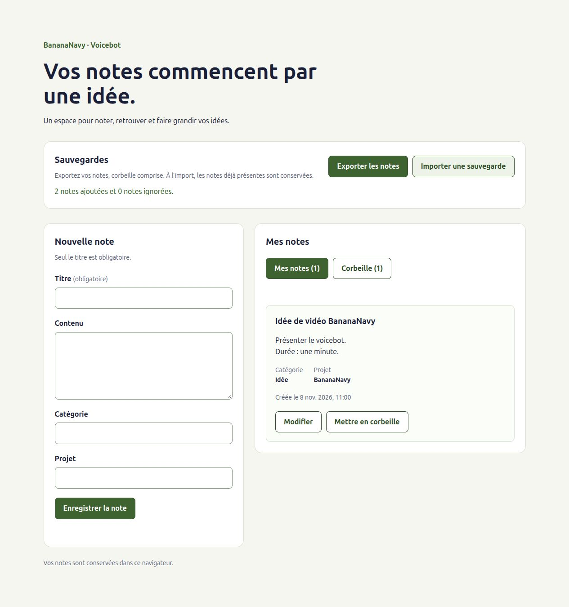

# Sauvegardes JSON

## Responsabilités

- `src/services/notesBackup.js` prépare et lit les fichiers, puis valide leur contenu.
- `src/services/notesStorage.js` accède à IndexedDB. Sa fonction `fusionnerNotes`
  vérifie les identifiants locaux et ajoute les notes absentes dans une transaction.
- Le composant `NotesBackup` télécharge le fichier et ouvre le sélecteur d'import.
  Les services restent utilisables depuis la console du navigateur.
- L'action `importerSauvegarde` du store coordonne l'import puis la relecture
  pour actualiser la liste sans rechargement. Elle sera utilisée par l'interface.

La version du format de sauvegarde est indépendante de la version de la base.
Le fichier inclut les notes actives et celles de la corbeille.

## Format et règles

```json
{
  "version": 1,
  "exportedAt": "2026-11-08T12:00:00.000Z",
  "notes": [
    {
      "id": "1aa591dc-271a-42ab-859e-ef63d67c393d",
      "titre": "Idée de vidéo",
      "contenu": "Présenter BananaNavy.",
      "categorie": "Idée",
      "projet": "BananaNavy",
      "createdAt": "2026-11-08T11:00:00.000Z",
      "updatedAt": "2026-11-08T11:00:00.000Z",
      "deletedAt": null
    }
  ]
}
```

`version` doit être le nombre `1`. `exportedAt` doit être une date ISO UTC au
format produit par `toISOString()` ; `notes` doit être un tableau, éventuellement
vide.

Pour chaque note :

- `id`, `titre`, `contenu`, `categorie` et `projet` doivent être des chaînes.
- `id` et `titre` ne doivent pas être vides ou composés uniquement d'espaces.
- `createdAt` et `updatedAt` doivent être des dates ISO UTC canoniques.
- `deletedAt` doit être `null` ou une date au même format.
- Un identifiant ne doit pas apparaître plusieurs fois dans le fichier.

Les valeurs sont conservées sans recréer la note via `creerNote` : cela préserve
son identifiant, ses dates et son texte. Les propriétés supplémentaires sont
écartées. La même validation est appliquée à l'export pour éviter de produire
un fichier impossible à réimporter si la base contient une note mal formée.

## Fusion sans écrasement

Si un identifiant existe déjà dans IndexedDB, la note locale est conservée dans
son intégralité, qu'elle soit active ou dans la corbeille. Aucune comparaison
automatique des dates n'est effectuée. Un même titre avec un autre identifiant
correspond à une autre note et peut être ajouté.

Le résultat `{ importees: 2, ignorees: 1 }` signifie que deux notes ont été ajoutées
et qu'une note du fichier existait déjà localement. Réimporter le même fichier
n'ajoute pas de doublons. Un import vide renvoie deux compteurs à zéro.

La validation de toutes les notes précède l'accès à la base. La vérification des
identifiants locaux et les ajouts sont ensuite effectués dans la même transaction
`readwrite`. Aucun succès n'est renvoyé avant sa fin. Une erreur annule tous les
ajouts de l'import, en conservant les notes précédemment présentes.

## Essayer dans la console

Démarrer `npm run dev` et ouvrir l'application dans le navigateur. Les chemins
`/src/` ci-dessous fonctionnent avec le serveur Vite de développement.

Créer le fichier en mémoire et consulter son contenu :

```js
const { exporterNotes, importerNotes } = await import('/src/services/notesBackup.js')
const fichierSauvegarde = await exporterNotes()
console.log(fichierSauvegarde.name)
console.log(await fichierSauvegarde.text())
```

Pour le télécharger manuellement depuis cette console :

```js
const urlSauvegarde = URL.createObjectURL(fichierSauvegarde)
const lienSauvegarde = document.createElement('a')
lienSauvegarde.href = urlSauvegarde
lienSauvegarde.download = fichierSauvegarde.name
document.body.append(lienSauvegarde)
lienSauvegarde.click()
lienSauvegarde.remove()
setTimeout(() => URL.revokeObjectURL(urlSauvegarde), 1000)
```

Vérifier la réimportation du même fichier en mémoire :

```js
console.log(await importerNotes(fichierSauvegarde))
```

Comme les notes existent déjà, le résultat doit indiquer zéro note importée et
autant de notes ignorées que de notes exportées. L'export vide est aussi valide.
Pour une restauration depuis le disque, le sélecteur de fichier fournit
un objet `File` à l'action `importerSauvegarde` de `useNotes`, qui appelle ce
service et actualisera les notes du store. Un appel direct au service dans la
console ne rafraîchit pas un provider déjà monté.

Si l'import est enregistré mais que cette actualisation échoue, le store demande
un rechargement et bloque les actions sur l'ancienne liste. L'erreur possède
`importEnregistre: true` et les compteurs dans `resultatImport` ; les notes restent
enregistrées en base. Voir [le guide du store](STORE.md).

## Vérifications du 8 novembre 2026

Essais automatisés ponctuels dans Chrome sans interface, avec un profil isolé,
une origine locale temporaire et une copie des modules du projet :

- Fichier JSON avec nom daté, métadonnées et export vide valides.
- Export puis réimport dans une base vidée pour l'essai : contenu avec accents
  et retours à la ligne, identifiants, dates et corbeille conservés.
- Réimport sans doublon et conservation d'une modification locale.
- Fichiers JSON invalides, versions inconnues, champs manquants ou de mauvais
  type, dates invalides et identifiants répétés refusés avant ouverture de la base.
- Erreur de lecture du fichier propagée avec sa cause.
- Import vide accepté et propriétés inconnues écartées.
- Échecs synchrones, erreur de contrainte IndexedDB et annulation après des ajouts
  réussis : aucun ajout partiel conservé et notes locales inchangées.
- Deux imports simultanés du même fichier sans doublon.
- Notes importées retrouvées après fermeture/réouverture du navigateur et
  rechargement ; nouvel export identique aux notes attendues.

La compilation et la syntaxe des modules ont aussi été vérifiées. Ces essais
n'utilisent pas les données du navigateur habituel. L'épuisement réel du quota et
les autres navigateurs restent à vérifier.

## Utilisation depuis l'interface

Le panneau Sauvegardes se trouve au-dessus du formulaire et des listes.

1. Cliquer sur « Exporter les notes » : le navigateur reçoit un fichier
   `voicebot-notes-AAAA-MM-JJ.json`, avec toutes les notes et la corbeille.
2. Conserver ce fichier sur le disque. L'application indique seulement que le
   téléchargement a été demandé ; sa finalisation dépend du navigateur.
3. Cliquer sur « Importer une sauvegarde » et sélectionner ce fichier.
4. Consulter les compteurs et les listes actualisées. Réimporter le même fichier
   doit ignorer les identifiants déjà présents sans les écraser.

Le filtre `.json,application/json` guide le sélecteur, sans remplacer la validation
du contenu. L'annulation du sélecteur ne lance pas d'import. La valeur du champ
fichier est remise à zéro pour autoriser une nouvelle sélection du même fichier.

`NotesBackup` gère l'opération en cours, un verrou de double appel et ses messages.
Il bloque ses commandes pendant l'opération, le chargement ou si le store demande
un rechargement. Les erreurs d'export restent locales au panneau ; celles d'import
sont affichées par `App` depuis le store pour éviter deux alertes identiques.
Après un import enregistré dont la relecture échoue, les compteurs connus restent
affichés avec le message de rechargement du store.

L'export crée une URL d'objet temporaire et un lien de téléchargement. Le lien est
retiré après le clic et l'URL libérée une seconde plus tard, après le démarrage
du téléchargement. La règle CSS `input[hidden]` maintient le sélecteur natif masqué
malgré le style commun `display: block` des champs.

### Vérifications des commandes de sauvegarde

Parcours dans le navigateur intégré avec uniquement des notes de démonstration :

- Import depuis le sélecteur sur une origine vide : deux notes ajoutées, dont une
  dans la corbeille ; compteurs et liste actualisés sans rechargement.
- Sélection du même fichier : zéro ajout, deux notes ignorées, sans doublon.
- Téléchargement réel et inspection du JSON enregistré sur disque : version 1,
  identifiants, contenu, dates et corbeille identiques aux données attendues.
- Fichier JSON invalide : une seule alerte, notes inchangées, sélecteur réinitialisé
  et commandes réutilisables. Import vide : deux compteurs à zéro.
- Modification locale suivie du réimport de l'ancienne sauvegarde : contenu local
  conservé et notes ignorées comptabilisées.
- Restauration du fichier réellement téléchargé dans une seconde origine vide :
  notes actives et corbeille retrouvées, puis persistance après rechargement.
- Captures inspectées sur ordinateur et mobile, sans débordement à 320 et 390 px.

Les blocages de transaction et la relecture échouée après import ont déjà été
forcés dans les essais du store ; cette étape n'a pas réinjecté ces erreurs dans
le panneau. Les annulations du sélecteur, les autres navigateurs et les refus
de téléchargement du navigateur restent à vérifier.



[Version mobile](images/interface-sauvegardes-mobile.png)
