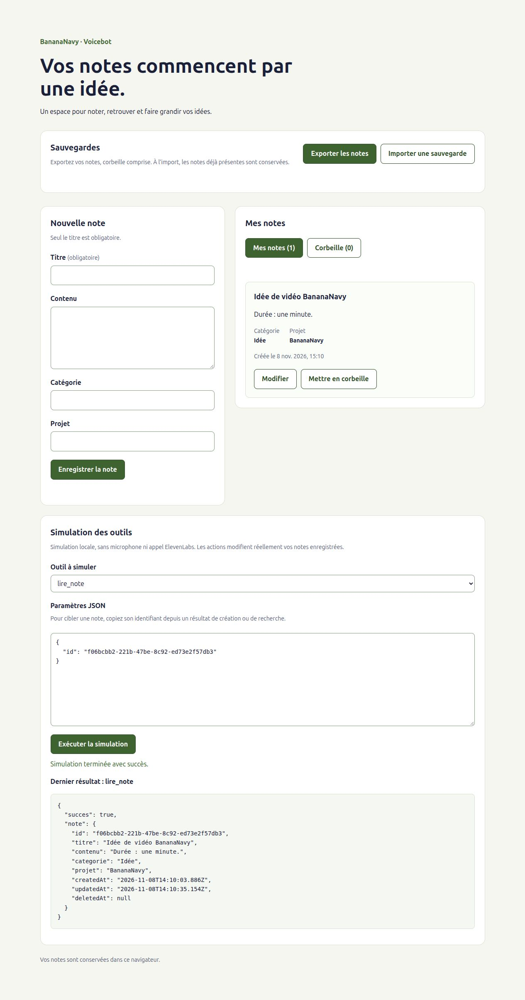

# Simulation locale des outils

## But et fonctionnement

Le panneau « Simulation des outils » permet d'exécuter manuellement les six outils
également utilisés par l'agent ElevenLabs. Il ne simule pas une conversation
en langage naturel : il simule l'appel d'un outil avec ses paramètres JSON.

Les effets sur les notes sont réels et sauvegardés dans IndexedDB. Aucune connexion
vocale, aucun microphone et aucun appel ElevenLabs ne sont utilisés.

`ToolsSimulator.jsx` lit le store avec `useNotes`, crée l'adaptateur avec
`creerOutilsNotes(store)`, puis appelle l'outil sélectionné. Il ne duplique pas les
règles métier et de validation documentées dans [OUTILS.md](OUTILS.md).

## Utiliser le panneau

1. Choisir l'outil : le panneau prépare un exemple de paramètres.
2. Adapter le JSON. Pour cibler une note, remplacer `IDENTIFIANT_DE_LA_NOTE` par
   l'identifiant exact obtenu lors d'une création ou recherche.
3. Cliquer sur « Exécuter la simulation ».
4. Lire le résultat structuré et observer les notes dans les listes.

La sélection et le JSON sont des états locaux contrôlés. Le changement d'outil
remplace les paramètres par son exemple, mais conserve le dernier résultat,
étiqueté avec le nom de l'outil réellement exécuté. Cela permet de récupérer un
identifiant même après avoir changé la sélection.

Les contrôles sont désactivés pendant le chargement, l'exécution et lorsqu'un
rechargement est requis. Un verrou empêche les soumissions simultanées. Après
une erreur, le JSON saisi est conservé pour permettre sa correction.

Le texte est lu par `JSON.parse`, sans exécution de code. Un JSON mal formé
renvoie un échec local sans appeler d'outil. Les erreurs de paramètres et de
règles métier proviennent de la couche commune. Le résultat est affiché comme
du texte JSON, jamais comme du HTML, avec une annonce de succès ou d'échec.

## Scénario de démonstration reproductible

Lancer `npm run dev`, ouvrir l’application puis déplier « Ouvrir le simulateur »
sous la conversation, dans l’espace de gauche.
Utiliser uniquement des notes de démonstration.

### Créer et rechercher

Choisir `creer_note`, conserver l'exemple, puis exécuter. La note apparaît dans
Mes notes. Copier la valeur `note.id` du résultat, sans les guillemets.

Choisir `chercher_notes` et exécuter :

```json
{ "texte": "BananaNavy", "corbeille": false, "limite": 5 }
```

Retrouver l'identifiant, le titre et l'extrait. Le nombre `total` peut dépasser
le nombre de résultats affichés si la limite est atteinte.

### Lire et modifier

Choisir `lire_note`. Remplacer la valeur d'exemple ci-dessous par l'identifiant
copié, puis exécuter :

```json
{ "id": "IDENTIFIANT_DE_LA_NOTE" }
```

Le résultat de lecture doit contenir le texte complet. Choisir `modifier_note`,
remplacer à nouveau l'identifiant puis exécuter :

```json
{
  "id": "IDENTIFIANT_DE_LA_NOTE",
  "changements": { "contenu": "Durée : une minute." }
}
```

Vérifier le contenu de la carte puis recharger la page. La note conserve sa
modification ; le panneau revient à son exemple initial. Conserver l'identifiant
copié ou le retrouver avec une recherche après rechargement.

### Mettre en corbeille et restaurer

Choisir `supprimer_note` et exécuter `{ "id": "IDENTIFIANT_DE_LA_NOTE" }` avec
l'identifiant réel. La note quitte Mes notes et le compteur de la corbeille augmente.
Recharger : la note doit toujours être en corbeille.

Choisir `restaurer_note` avec le même identifiant. La note revient dans Mes notes,
avec son contenu d'une minute. Une nouvelle lecture et un rechargement doivent
confirmer son état actif. Aucune suppression définitive n'est effectuée.

### Vérifier les erreurs

- Saisir `{` : le panneau doit signaler un JSON invalide sans modifier les notes.
- Avec `lire_note`, saisir `{ "id": 12 }` : le paramètre doit être refusé.
- Utiliser un identifiant absent : le résultat doit indiquer « Note introuvable. ».
- Avec `modifier_note`, tenter de changer `id` dans `changements` : refus du champ.

Corriger les paramètres puis réexécuter. Une erreur ne doit pas être présentée
comme une sauvegarde réussie.

## Vérifications du 8 novembre 2026

- `npm test` et compilation réussis.
- Parcours via le navigateur intégré sur une origine locale dédiée : les six
  outils exécutés depuis le panneau, listes et compteurs actualisés.
- Exemple adapté à chaque outil, dernier résultat conservé avec son nom lors
  d'un changement de sélection, lecture du contenu complet et mutation résumée.
- JSON mal formé, identifiant de mauvais type, identifiant inconnu et champ
  protégé refusés, paramètres conservés après les échecs.
- Modification et suppression retrouvées après rechargement ; restauration puis
  nouvelle lecture confirmant l'état actif et le contenu sauvegardé.
- Identifiants des contrôles uniques, navigation Tab du JSON vers le bouton,
  rendu inspecté sur ordinateur et mobile sans débordement à 320 et 390 px.



[Version mobile](images/interface-simulation-mobile.png)

## Limites

Seuls le dernier résultat et les paramètres courants sont affichés ; ils ne sont
pas sauvegardés après rechargement. Il n'y a ni historique de conversation,
interprétation par un modèle, transcription ou audio simulé.

Le verrou porte sur les appels simultanés, pas sur les demandes répétées après
réussite : chaque nouvelle invocation de `creer_note` crée une nouvelle note.
La déduplication des appels vocaux reste à prévoir malgré l'intégration de l'agent.
Les autres navigateurs et lecteurs d'écran restent à vérifier.
